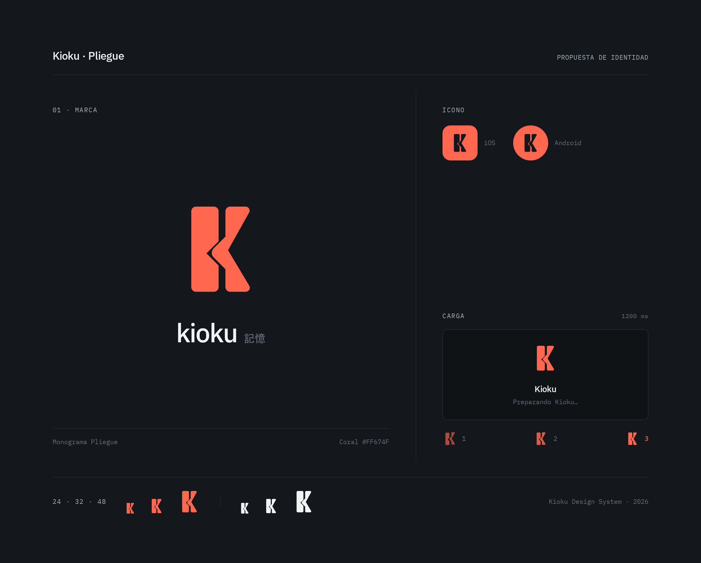

# Kioku · Propuesta de marca «Pliegue»

Fecha: 2026-11-13. **Propuesta pendiente de elección del propietario**, todavía sin integrar en la app. Se crea antes de rediseñar el login, por petición explícita. Se conserva la estética B.

## Fuente y archivos

- [Proyecto Stitch](https://stitch.google.com/projects/11852641719392883248), lámina «Marca · Pliegue — propuesta», junto a las pantallas móviles existentes.
- Pantalla final: `c76dd0bdd5a94cb3a3cb20c10b731d7a`; primer borrador: `a41897762ed640d2b1b6cd69f640a15f`. La refinada está colocada en el canvas; no se borran recursos anteriores.
- [Lámina PNG](../assets/branding/kioku-pliegue-proposal.png), descargada mediante Stitch MCP.
- [Símbolo SVG](../assets/branding/kioku-pliegue-proposal.svg), extraído de los dos paths de la lámina sin cambiar su geometría. Vector de propuesta, sin scripts, fuentes o imágenes externas.

## Dirección visual

Monograma que sugiere una K mediante dos trazos sólidos y un encuentro central en forma de pliegue. El símbolo funciona por sí solo; el nombre `kioku` y 記憶 lo acompañan en la presentación. Coral `#FF674F`, carbón `#14171B`, blanco roto `#F2F3F4` e IBM Plex Sans mantienen la relación con B.

La lámina presenta símbolo, máscaras de icono iOS/Android, tamaños de 24/32/48 px y el mismo símbolo aplicado a carga. El icono usa fondo coral y símbolo carbón; la marca interior usa coral sobre carbón. Las máscaras son demostraciones, no iconos nativos listos para distribución.

## Carga propuesta

Dos trazos con desplazamiento de aproximadamente 2–3 px y opacidad suave, ciclo de 1200 ms. La demostración HTML de Stitch incluye `prefers-reduced-motion`: símbolo completo estático. El texto «Preparando Kioku…» describe espera general, sin porcentajes o confirmaciones de guardado. Los tres fotogramas muestran el movimiento propuesto, no estados de una operación real.

## Revisión y límites

| Perspectiva | Hallazgo y revisión |
| --- | --- |
| Diseño | El primer borrador tenía demasiadas cajas, badges y etiquetas técnicas. Se refinó a una lámina horizontal con foco en la marca y aplicaciones secundarias |
| Ingeniería | Se contrastaron los SVG del HTML: solo dos paths geométricos normalizados en todos los usos. El export conserva ambos; siguen pendientes los recursos/animación nativos y su prueba en dispositivos |
| Producto | Se retiró «Encapsulando recuerdo» de la carga porque sugería un guardado inexistente. Se mantienen las ocho pantallas anteriores y no se adelanta el login con una marca aún no elegida |

Revisión visual de escala y monocromo sobre la lámina, no pruebas instrumentadas de iconos/animación. La forma expresa bien la inicial; su asociación emocional con la memoria y el peso de la referencia japonesa son decisiones de gusto pendientes del propietario. No se declara aprobación, fidelidad nativa, rendimiento o accesibilidad completa a partir de una imagen.

La siguiente decisión de diseño es elegir/ajustar el símbolo y después aplicarlo al login, conservando la marca oficial del botón Google. El código funcional de acceso y el logo instalado permanecen sin cambios en esta entrega.
