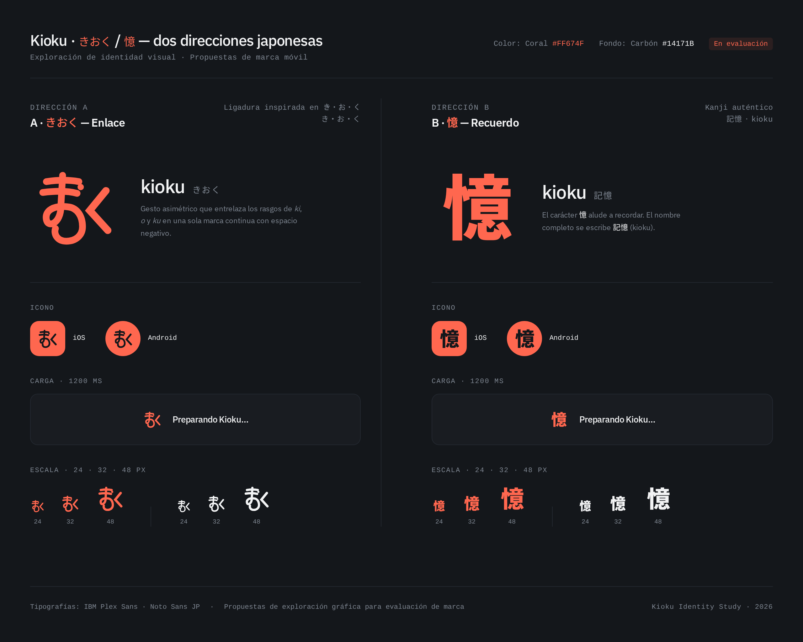
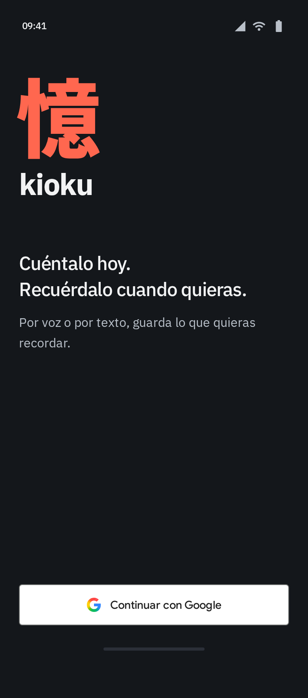
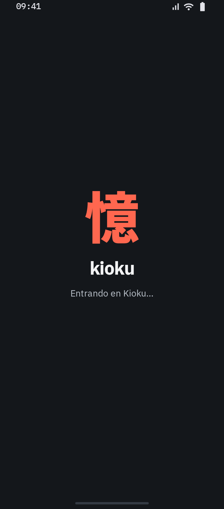
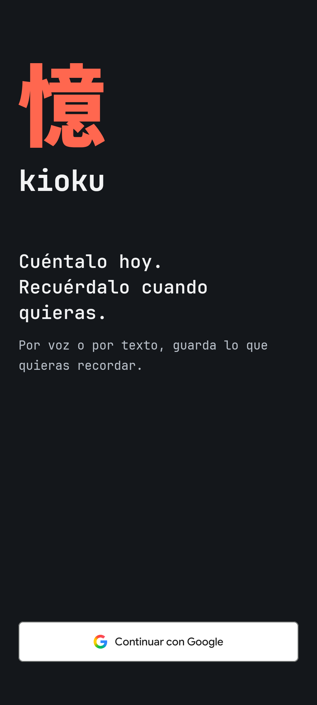
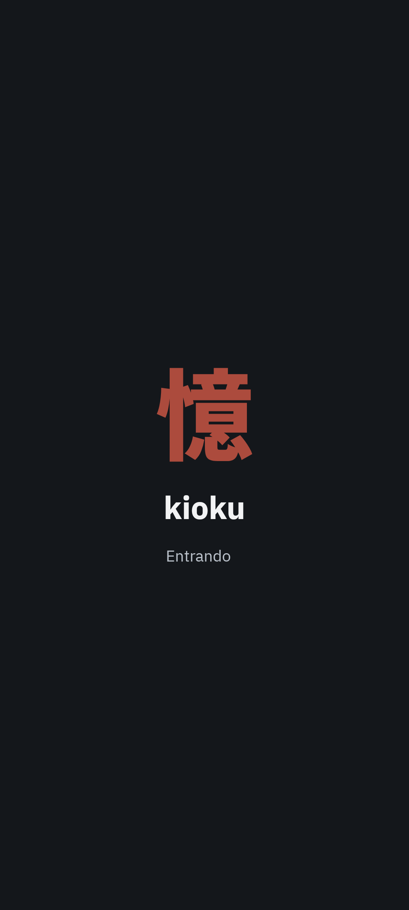

# Kioku · Marca japonesa y acceso

Fecha: 2026-11-13. **El propietario elige B: el kanji 憶**, con el tratamiento Noto Sans JP de peso 900 de la comparación. La ligadura de hiragana queda como alternativa no seleccionada y Pliegue como propuesta descartada. Después de aprobar el login y la carga en Stitch, solicita aplicarlos a Android e iOS. Están implementados en Compose compartido y preparados los iconos de ambos hosts; APK y pruebas Android comprobados. El nuevo build iOS necesita validación en Mac. No se han actualizado instalaciones personales.

## Fuente y archivos

- [Proyecto Stitch](https://stitch.google.com/projects/11852641719392883248), comparación «Marca · 憶 elegida — comparación previa», a la derecha de las ocho pantallas móviles. El nuevo acceso y la carga están en una fila superior.
- Pantalla refinada: `8d80246de1ff4098a6137efc6a5e267b`; primer borrador: `884ce4117b754bef8ec42ada430f3260`.
- [Lámina PNG](../assets/branding/kioku-japanese-proposals.png), descargada mediante Stitch MCP.
- Fuentes consultadas: [glosario](../00-product/GLOSSARY.md), [autoridad visual](STITCH_SOURCE.md), [pantallas](SCREEN_SPECIFICATIONS.md), [flujos](FLOWS.md), propuesta anterior y [definición de terminado](../07-development/DEFINITION_OF_DONE.md). Para el rediseño se revisaron también los estados y la vista de cuenta existentes, sin modificarlos.

## Las dos direcciones

| Propuesta | Construcción y significado | Límite |
| --- | --- | --- |
| A · Enlace · No elegida | Ligadura gráfica inspirada en rasgos de き・お・く: barras superiores, bucle inferior y ángulo abierto a la derecha | Es una marca inventada; no un nuevo carácter japonés ni una lectura literal inequívoca de las tres sílabas |
| B · Recuerdo · Elegida | Carácter auténtico 憶, en Noto Sans JP de peso 900, conservando sus componentes | El nombre completo se escribe 記憶 y se lee kioku; 憶 aislado no se lee kioku. La maqueta HTML usa la fuente; la implementación ya usa un contorno vectorial autónomo |

La referencia lingüística es Kanjipedia: [記憶](https://www.kanjipedia.jp/kotoba/0001223600) y [憶](https://www.kanjipedia.jp/kanji/0000556600). Modernizar significa aquí un tratamiento tipográfico contemporáneo del carácter, sin inventar trazos a los que atribuir un significado japonés.

Coral `#FF674F`, carbón `#14171B`, blanco roto `#F2F3F4` e IBM Plex Sans conservan la relación con B. Ambas direcciones incluyen símbolo principal, demostraciones de máscaras iOS/Android, tamaños de 24/32/48 px, monocromo y aplicación a carga. Esas máscaras son muestras visuales; los recursos nativos de la dirección elegida se describen en la implementación.

## Carga de la comparación previa

El HTML de Stitch propone un pulso suave de opacidad en un ciclo de 1200 ms; A añade un desplazamiento vertical pequeño. Incluye `prefers-reduced-motion` para mostrar el símbolo estático completo. «Preparando Kioku…» describe una espera general, sin implicar un guardado confirmado. La lámina PNG es estática y no demuestra la animación ejecutándose en Android o iOS.

## Login y carga del acceso con Google

Diseñados en Stitch tras la elección de 憶 e implementados posteriormente en Compose compartido para Android/iOS. La tabla identifica la referencia visual, no una compilación nativa.

| Vista | Recurso final Stitch | Export |
| --- | --- | --- |
| 00 · Acceso — 憶 | `ed94dbb464fb4c46bd8835748c034375` | [PNG de acceso](../assets/branding/kioku-login-kanji.png) |
| 00b · Entrando en Kioku — 憶 | `5f51990c8a7e418186593be8863e865c` | [PNG de carga](../assets/branding/kioku-login-loading-kanji.png) |

| Acceso | Carga |
| --- | --- |
|  |  |

El acceso tiene marca y texto alineados a la izquierda: «Cuéntalo hoy. Recuérdalo cuando quieras.» y «Por voz o por texto, guarda lo que quieras recordar.». Solo una acción, «Continuar con Google», en la zona inferior. El kanji es coral sobre carbón; no se añade un segundo botón coral que compita con Google.

El botón toma como referencia las [directrices oficiales Google](https://developers.google.com/identity/branding-guidelines): blanco, borde `#747775`, radio 4 px, Google Sans Medium 14/20, G de 18 px y altura mínima de 52 px. La primera revisión detectó Roboto en el HTML y una sustitución incorrecta de la imagen G. Se corrigió incorporando el vector del [paquete oficial Google](https://developers.google.com/static/identity/images/signin-assets.zip) como SVG inline, conservando su geometría y gradiente. Se comprobó visualmente la G renderizada; no se interpreta como certificación del proveedor. La implementación deberá utilizar sus recursos/SDK oficiales, sin copiar el HTML generado como arquitectura.

La carga muestra 憶, kioku y **«Entrando en Kioku…»**. El HTML final conserva un pulso de opacidad entre 0,4 y 1 en 1200 ms, sin giro o deformación, y símbolo estático al activar `prefers-reduced-motion`. El texto de estado permanece legible y estable. El ciclo de animación no establece la duración del acceso: termina con el resultado real de la operación. No hay progreso numérico, recuerdos privados ni éxito anticipado. Google controla su selector nativo; Kioku permanece detrás y continúa mostrando la carga al volver mientras resuelve sesión/configuración. Cancelación y fallos siguen las salidas descritas en [flujos](FLOWS.md).

### Revisión de la entrega

| Perspectiva | Evidencia y límites |
| --- | --- |
| Diseño | Dos rondas de refinamiento tras el borrador: bloque inicial adelantado, G corregida, tipografía Google Sans y fondo carbón unificado. Kanji y único CTA concentran la jerarquía; no hay tarjetas, gradientes decorativos o enlaces de relleno |
| Ingeniería | Inspección de HTML: fuente Google Sans, SVG oficial inline, fondo `#14171B`, semántica de estado y Reduce Motion. La maqueta no autentica ni acredita prevención de doble envío funcional: la app seguirá vinculándola al estado de cuenta real |
| Producto | Explicación breve de voz/texto y un único acceso. Carga ligada a `SignedOut(busy = true)` / `Loading`, sin nuevo destino ni pausa artificial. No se cambian autorización, servidor o gestión de clave |
| Accesibilidad | Contraste calculado de los colores sólidos: texto principal 16,18:1 y secundario 9,80:1 sobre carbón; texto Google 16,48:1 sobre blanco. Se retiró el bloqueo de zoom y se revisó la estructura flexible del HTML. Lectores de pantalla, texto al 200 %, insets y animación nativos aún necesitan validación en dispositivos |

Se verificó mediante Stitch MCP que ambas vistas están colocadas en el canvas y que los recursos HTML/imagen de las ocho vistas anteriores no cambian. Los exports son PNG estáticos de 780 × 1768; no demuestran autenticación real ni animación ejecutándose. No se atribuye una puntuación de accesibilidad, rendimiento o calidad nativa a una maqueta.

## Revisión y límites

- El primer símbolo A se parecía demasiado a ま. Se pidió una revisión en Stitch para distinguir el ángulo de く y el bucle inferior, y se inspeccionó el resultado. La lectura de los hiragana sigue siendo interpretativa.
- Se corrigieron las descripciones de B para distinguir el carácter 憶 del nombre completo 記憶. Se retiraron etiquetas técnicas innecesarias de los ejemplos de carga.
- Se revisaron visualmente ambas alternativas, sus muestras pequeñas y monocromas. No se atribuyen pruebas nativas, legibilidad universal ni aprobación del propietario a esta lámina.
- Tras colocar la comparación en el canvas, Stitch MCP confirmó que los recursos HTML e imagen de las ocho pantallas móviles permanecen sin cambios. La propuesta Pliegue queda oculta y rotulada como descartada; sus archivos se conservan.
- La comparación no modificó código funcional de acceso, secretos, logo instalado o datos. Tras elegir B, se diseñó el login y su carga en Stitch y el propietario pidió implementarlos; la evidencia de esa entrega figura a continuación.

## Implementación compartida y recursos nativos

**Ajuste posterior solicitado:** el mensaje actual es **«Entrando...»**. El texto «Entrando» y el ancho completo de tres puntos se miden siempre; solo cambia el recorte de dibujo de los puntos (ninguno, uno, dos, tres) cada 300 ms, en un ciclo de 1200 ms. Por tanto, la animación no modifica medidas ni recentra la palabra. Con MotionDurationScale cero queda el texto completo estático. El anuncio accesible es constante, sin repetirlo en cada fotograma. La referencia Stitch conserva el texto anterior; el ajuste posterior del propietario prevalece según STITCH_SOURCE.

Para este ajuste se repitieron compilación de APK/tests, `mobileCheck` (incluidos 17 host tests) y los cuatro casos instrumentados de `AccountAccessTest`, todos correctos. Se actualizó la captura Android de carga con una cuenta ficticia. El resto de la suite de 13 corresponde a la entrega anterior descrita más abajo; no se presenta como repetida para este cambio menor. La validación iOS sigue pendiente en Mac.

Se implementan `LoginScreen`, `AccountLoadingScreen` y la marca compartida en `shared`. `AccountScreen` muestra la carga tanto para `SignedOut(busy = true)` como para `Loading`; desaparece al resolver la operación real. Cancelación vuelve al acceso, fallo de Google permite recuperación y configuración denegada conserva Reintentar/Cerrar sesión. No se modifican ViewModel, repositorio, permisos remotos o secretos. Al volver al acceso se retira el foco/teclado; el padding de IME queda en el área autorizada. No se monta una conversación antes de obtener `Authorized`.

La distribución mantiene el bloque superior y un único botón Google inferior. En pantallas pequeñas o con letra ampliada, el contenido se desplaza: se conserva el tamaño de texto y los controles siguen alcanzables. La G y Google Sans ya existentes siguen siendo recursos oficiales empaquetados; el botón ocupa el ancho disponible, tiene altura mínima de 52 dp y G de 18 dp. El encabezado de la app incorpora el mismo kanji pequeño; las pantallas con retorno conservan su botón Volver.

La animación nativa varía solo la opacidad del kanji entre **0,65 y 1**, en un ciclo completo de 1200 ms; se eleva el mínimo respecto a la maqueta para mantener más visible la marca. La información de espera permanece estática y se anuncia como progreso indeterminado mediante semántica y live region. Se usa `InfiniteTransition`, que respeta `MotionDurationScale`: al desactivar animaciones termina en opacidad 1. Se inspeccionó la implementación fijada de Compose 1.12.0 y su vínculo con Reduce Motion de iOS; esto no sustituye la prueba en un dispositivo Apple.

- [SVG maestro](../assets/branding/kioku-kanji.svg): contorno del glifo U+61B6 a peso 900, sin dependencia de fuentes del dispositivo, scripts o imágenes externas. Mismo path en el recurso Compose y los vectores Android.
- Android: icono adaptativo coral/carbón con capa monocroma, geometría dentro de la zona segura y marca coral en el arranque del sistema API 31+. No se añade demora al arranque.
- iOS: catálogo `Assets.xcassets` conectado a recursos de Xcode y `AppIcon` seleccionado en la configuración. Dieciocho PNG opacos cubren slots iPhone/iPad/marketing; no contienen esquinas redondeadas prefabricadas.
- Procedencia/hash/licencia en [Noto](../../licenses/noto-sans-jp-sources.json), [OFL Noto](../../licenses/noto-sans-jp-OFL.txt) y [IBM](../../licenses/ibm-plex-sources.json). Se añade IBM Plex Sans Bold para el wordmark, sin descargar fuentes en ejecución.

### Validación del 13 de noviembre

| Comprobación | Resultado y límite |
| --- | --- |
| APK y APK de tests | `:androidApp:assembleDebug` y `:androidApp:assembleDebugAndroidTest` correctos; firma local y paquete `.dev` conservados |
| Calidad móvil | `mobileCheck`: formato, arquitectura, Detekt, 17 host tests y Android Lint correctos, sin errores ni avisos evitables |
| Interfaz | 13/13 instrumentados correctos en el emulador API 36, texto del sistema al 200 %. Incluye cuatro casos nuevos: cancelación, espera de configuración sin acceso prematuro, error recuperable y ventana de 320 × 480 dp con texto al 200 % |
| Regresión de salida | El intento inicial falló al pulsar controles fuera de vista con texto ampliado. El test ahora se desplaza hasta Cerrar sesión y Google y mantiene las aserciones de visibilidad, borrador retirado y nuevo acceso; no se eliminaron expectativas |
| Capturas | Caso de cancelación repetido a texto normal con captura de la superficie Compose; revisión visual de login/carga contra Stitch. Solo cuenta ficticia; se restauró el tamaño de texto del emulador |
| Recursos | Los tres vectores comparten path exacto. Los 18 PNG Apple tienen dimensiones de su slot y color RGB opaco. Generador repetido y formato Prettier verificado |
| iOS | Código común y catálogo preparados. Compilación Xcode, icono instalado, Google, VoiceOver y Reduce Motion del nuevo build pendientes en Mac; la confirmación previa del propietario corresponde al build anterior |

No se ejecutan llamadas OpenAI, despliegues o pruebas de backend para este cambio visual. No se acredita Google/atestación real con los dobles del emulador. TalkBack completo, Android API 29/37, paisaje y comprobaciones Apple siguen pendientes.

| Captura Android · acceso | Captura Android · carga |
| --- | --- |
|  |  |

### Regenerar los recursos de marca

[Generador](../../tooling/generate-brand-assets.mjs), sin dependencias añadidas a la app. Requiere Node 24, `fontkit@3.0.0` y `sharp@0.35.5` instalados únicamente en `.setup/brand-tools` (por ejemplo, `npm install --prefix .setup/brand-tools --no-save --package-lock=false --ignore-scripts fontkit@3.0.0 sharp@0.35.5`). Descargar la fuente desde la URL fijada en el registro Noto a `.setup/kioku-brand/NotoSansJP.ttf` y ejecutar `node tooling/generate-brand-assets.mjs`. El generador exige su SHA-256 aprobado y conserva la geometría, salvo escala uniforme y orientación de coordenadas. La fuente completa y las herramientas locales permanecen ignoradas por Git; los exports y licencias viajan en el repositorio para el Mac.

## Historial descartado: Pliegue

Monograma latino K en dos trazos, rechazado por el propietario el 2026-11-13. Pantalla refinada `c76dd0bdd5a94cb3a3cb20c10b731d7a`; primer borrador `a41897762ed640d2b1b6cd69f640a15f`. Se conservan la [lámina PNG](../assets/branding/kioku-pliegue-proposal.png) y el [símbolo SVG](../assets/branding/kioku-pliegue-proposal.svg) como historial, sin integrarlos en la app.
