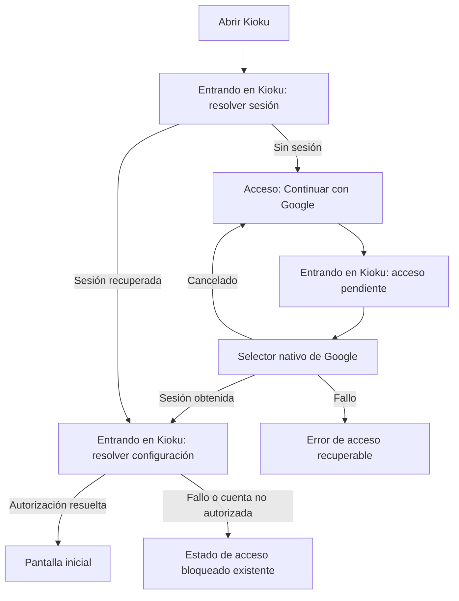
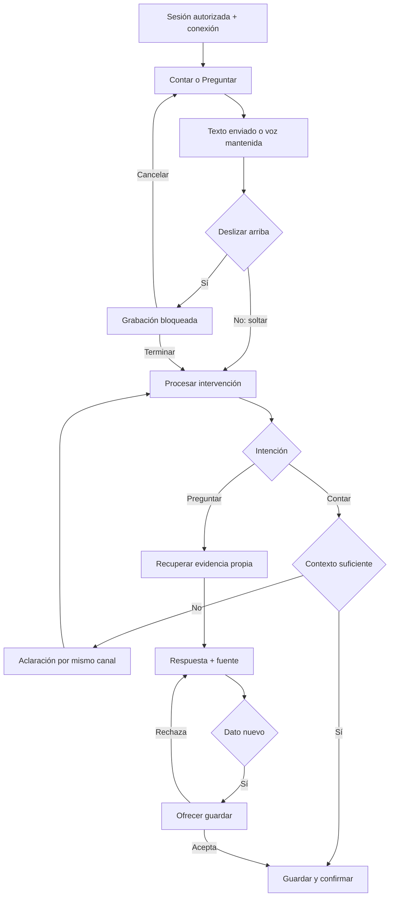

# Flujos y salidas

## Entrada y carga

El acceso visual usa el logo elegido 憶 y conserva el mecanismo Google existente:

La vista de carga permanece detrás de la interfaz nativa de Google y vuelve a verse tras su retorno mientras se resuelve el acceso. Representa `SignedOut(busy = true)` o `Loading`; no un nuevo destino de navegación ni una operación paralela. Sale al cambiar el estado real. No hay tiempo mínimo, porcentaje inventado o confirmación anticipada de éxito. La carga no solicita permisos ni muestra datos privados. Errores conservan las acciones de recuperación del estado existente; cancelar no se trata como error técnico.

## Memoria

## Estados y coherencia

Captura: `Idle → Holding → Locked? → Processing → NeedsClarification | Saved | Failed`. `Cancelled` nunca equivale a guardado. Preguntar: `Ready → Retrieving → Answering → Answered | NeedsClarification | InsufficientEvidence | Failed`.

La respuesta a una aclaración conserva la operación y su intención original. En una consulta, una corrección o borrado explícitos entran en UC-007/008; la mera aparición de información nueva entra en UC-006.

Olvidar: `Objetivo resuelto y vigente → Diálogo con texto/alcance → Cancelar | Confirmar → Aplicar → Confirmación del servidor → Aviso con el recuerdo`. Cancelar/cerrar no llama al borrado. Una aclaración de alcance ocurre antes del diálogo; una selección nueva necesita su propia confirmación. Un fallo incierto conserva el ID de la operación confirmada para comprobarla, sin repetir ni anunciar éxito. Revisiones/cuenta/caducidad obsoletas siguen impidiendo aplicar.

Toda fuente se abre con un retorno a la conversación que la referenció. No hay pestaña de biblioteca ni clasificación obligatoria. Se preserva el contexto durante un fallo; no se cambia de pantalla para simular éxito.

No solicitar permiso de micrófono al abrir la app: hacerlo al primer intento de voz. Permiso denegado mantiene disponible el texto. Una sesión invalidada cancela acceso privado y descarta resultados tardíos. Captura en segundo plano no está autorizada en V1; la política de interrupción y recuperación exacta se decidirá antes de implementar voz.

Continuidad de Gestión: selección actual → Corregir o popup coral de Olvidar → operación estable → confirmación del servidor → aviso en el mismo destino → lectura de fuentes/versiones vigentes → otra selección o volver. Se contemplan cero restos, una fuente conservada o una conservada y otra corregida. No se redirige automáticamente a Explicar. Volver durante una operación sin confirmación mantiene la invalidación conservadora; volver durante la lectura posterior conserva el cambio ya confirmado y el feed histórico autorizado.

Feed de sesión: conservar mensajes originales y anexar avisos de cambio; respuestas previas pasan a lectura histórica, sin fuentes/acciones antiguas. Los mensajes afectados pierden sus tres puntos y quedan deshabilitados; los datos vigentes solo se siguen gestionando dentro de Gestionar. Cambiar de intención recupera su feed completo. Segundo plano menor de 30 minutos → reautorizar y restaurar; 30 minutos o cierre/reinicio → ambos feeds/contextos vacíos, sin borrar recuerdos canónicos.

Refinamiento posterior: respuesta vigente de Preguntar → tres puntos → Gestionar → datos de las fuentes citadas con selección individual y su fecha de registro. Sin enlace Ver texto original; no hay menú sin fuentes. Corrección/olvido confirmado → título y detalle del dato o cambio de X a Y dentro del mismo recuadro, tanto en Gestionar como en el feed. Cada aviso conserva su detalle durante esa sesión, aunque se añadan turnos o cambie de intención; no forma contexto enviado ni permite gestionar valores retirados.
