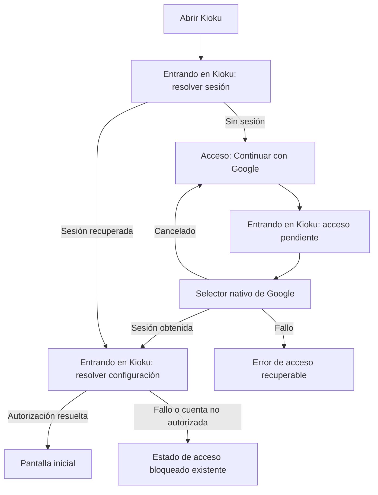
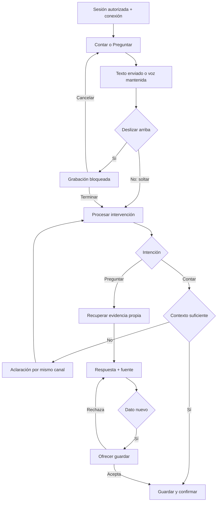

# Flujos y salidas

## Entrada y carga

El acceso visual usa el logo elegido 憶 y conserva el mecanismo Google existente:

La vista de carga permanece detrás de la interfaz nativa de Google y vuelve a verse tras su retorno mientras se resuelve el acceso. Representa `SignedOut(busy = true)` o `Loading`; no un nuevo destino de navegación ni una operación paralela. Sale al cambiar el estado real. No hay tiempo mínimo, porcentaje inventado o confirmación anticipada de éxito. La carga no solicita permisos ni muestra datos privados. Errores conservan las acciones de recuperación del estado existente; cancelar no se trata como error técnico.

## Memoria

## Estados y coherencia

Captura: `Idle → Holding → Locked? → Processing → NeedsClarification | Saved | Failed`. `Cancelled` nunca equivale a guardado. Preguntar: `Ready → Retrieving → Answering → Answered | NeedsClarification | InsufficientEvidence | Failed`.

La respuesta a una aclaración conserva la operación y su intención original. En una consulta, una corrección o borrado explícitos entran en UC-007/008; la mera aparición de información nueva entra en UC-006.

Toda fuente se abre con un retorno a la conversación que la referenció. No hay pestaña de biblioteca ni clasificación obligatoria. Se preserva el contexto durante un fallo; no se cambia de pantalla para simular éxito.

No solicitar permiso de micrófono al abrir la app: hacerlo al primer intento de voz. Permiso denegado mantiene disponible el texto. Una sesión invalidada cancela acceso privado y descarta resultados tardíos. Captura en segundo plano no está autorizada en V1; la política de interrupción y recuperación exacta se decidirá antes de implementar voz.
