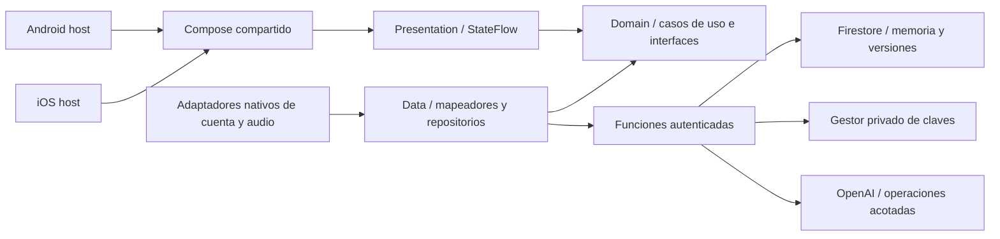

# Arquitectura

Revisión activa de fuentes: [ADR-017](ADR/ADR-017-unified-source-chat.md) sustituye el selector/biblioteca de consultas por un único chat. MainActivity recibe Compartir y conserva su host/VM; Fuentes queda como gestión privada con URL. La consulta opt-in combina evidencia personal/documental manteniendo almacenamiento, índices y atribución separados. El adaptador nativo relee versiones antes de abrir citas. [Pruebas locales y activación en Honor](../09-planning/UNIFIED_SOURCES_VALIDATION.md); las bases/piloto descritos debajo son históricos.

Base documental y [piloto conectado](../09-planning/SHARED_SOURCES_PILOT.md): [ADR-016](ADR/ADR-016-shared-reference-sources.md), [evidencia](../09-planning/SHARED_SOURCES_VALIDATION.md). `ReferenceWorkspaceRepository` es portable; el ViewModel controla estados/generaciones, citas y confirmación; Android controla Intent/URI/selector y transporte loopback. `PilotHost` compone con Koin en una aplicación separada y limpia su ViewModelStore/handles al cerrar. `backend/src/references` implementa extracción y autoridad transaccional; `backend/test/pilot` conecta únicamente Auth/Firestore demo con DTO estrictos y un solo worker simultáneo. No hay proveedor IA o descarga web arbitraria; el receptor de Kioku habitual sigue deshabilitado. No cambia el grafo activo de memoria ni el servidor desplegado.

Dictado: [ADR-015](ADR/ADR-015-dictation-draft.md) separa transcripción de envío. `VoiceCaptureHost` entrega solo `EditDraft` al parar; los parciales son presentación y solo el envío manual posterior inicia los casos de memoria. Sustituye el gesto de mantener/bloquear de ADR-014.

Revisión aceptada del 16 de noviembre: [núcleo de memoria v2](MEMORY_CORE_V2.md) y [ADR-012](ADR/ADR-012-independent-memory-units.md). Conserva estas fronteras y replantea evidencia, identidad y mutaciones. El [motor determinista R1](../09-planning/R1_VALIDATION.md) se prueba de forma aislada en RAM; interpretación, adaptación Firebase/app y migración siguen pendientes antes de sustituir K2–K4.

La evaluación [R2](../09-planning/R2_VALIDATION.md) añade un adaptador aislado de interpretación/revisión con Sol medio y materialización literal antes de R1. Su consulta usa un catálogo RAM completo acotado a 32 unidades: no constituye todavía el buscador escalable ni un servidor activable. No se importa desde el backend actual. Captura/corrección proponen datos; el modelo nunca decide el delta del olvido confirmado ni las precondiciones de escritura.

Decisión adaptada de Wonderdrop por petición del propietario. [ADR-001](ADR/ADR-001-platform-strategy.md) y [ADR-002](ADR/ADR-002-clean-architecture.md) sustituyen la dirección Expo inicial.

## Responsabilidades

- **UI:** renderizado e intenciones, gestos, accesibilidad y enlaces de navegación. No decide autorización, guardado, borrado ni persistencia.
- **Presentation:** ViewModels con estado inmutable; orquestan casos de uso y descartan respuestas de sesiones/operaciones obsoletas. No importan Firebase.
- **Domain:** modelos, reglas semánticas, errores y fronteras puras. Casos significativos: enviar intervención, resolver aclaración, consultar, aceptar propuesta, corregir y olvidar.
- **Data:** implementa repositorios, traduce DTO y errores, coordina transportes. Ningún snapshot o excepción nativa cruza al dominio.
- **Plataforma:** SDK oficiales Android/Apple para cuenta, micrófono, transcripción local y almacenamiento protegido de sesión/configuración no secreta. El host inyecta `VoiceInput` portable; `VoiceViewModel` gobierna estados/generaciones, sin SDK ni reproducción de respuestas en shared. Audio transitorio y compatibilidad según [ADR-014](ADR/ADR-014-local-voice-input.md).
- **Backend TypeScript:** autoriza por cuenta, protege clave y límites, interpreta con IA como entrada no confiable, persiste e indexa coherentemente. Mutaciones protegidas pasan por backend; ningún cliente escribe memoria canónica directamente.

Koin para DI, Navigation 3 tipada para rutas, coroutines estructuradas y Flow/StateFlow. K0 añade `shared`, `androidApp` e `iosApp`, catálogo/wrapper/lockfiles y una vista previa con fixtures; compilación y recorridos Android comprobados. Versiones y límites en [ADR-006](ADR/ADR-006-k0-toolchain.md). K1 añade adaptadores de cuenta nativos, estado seguro de configuración y frontera administrativa de credenciales; [ADR-008](ADR/ADR-008-k1-native-access-and-credentials.md). iOS sigue sin compilar/probar en Mac; acceso/atestación reales y estado remoto constan en la [evidencia actual](../09-planning/K1_INTEGRATION_VALIDATION.md).

El almacenamiento es online y asociado a identidad; no existe una base local de recuerdos ni una cola offline. El audio transitorio no equivale a archivo permanente. Véanse [dependencias](DEPENDENCY_RULES.md), [estado](STATE_MANAGEMENT.md), [datos](../03-data/DATA_MODEL.md) y [API](../04-api/API_CONTRACT.md).

K2 reutiliza el núcleo M0 compilado desde sus fuentes y añade captura transaccional, aclaraciones y recuperación de recibo en servidor; [ADR-009](ADR/ADR-009-text-capture.md). Domain incorpora comandos/resultados de captura y repositorio portable. Data valida el protocolo y suspende sobre un puente nativo Functions cancelable; UI/ViewModel mantienen estado, intención y generación. El repositorio de la instancia actual se pasa explícitamente al ViewModel por parámetros Koin, igual que la cuenta, para no retener una dependencia de otra composición. [Evidencia local, despliegue y aceptación móvil pendiente](../09-planning/K2_VALIDATION.md).
