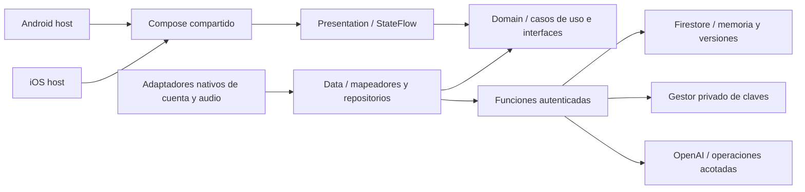

# Arquitectura

Decisión adaptada de Wonderdrop por petición del propietario. [ADR-001](ADR/ADR-001-platform-strategy.md) y [ADR-002](ADR/ADR-002-clean-architecture.md) sustituyen la dirección Expo inicial.

## Responsabilidades

- **UI:** renderizado e intenciones, gestos, accesibilidad y enlaces de navegación. No decide autorización, guardado, borrado ni persistencia.
- **Presentation:** ViewModels con estado inmutable; orquestan casos de uso y descartan respuestas de sesiones/operaciones obsoletas. No importan Firebase.
- **Domain:** modelos, reglas semánticas, errores y fronteras puras. Casos significativos: enviar intervención, resolver aclaración, consultar, aceptar propuesta, corregir y olvidar.
- **Data:** implementa repositorios, traduce DTO y errores, coordina transportes. Ningún snapshot o excepción nativa cruza al dominio.
- **Plataforma:** SDK oficiales Android/Apple para cuenta, micrófono, audio temporal, reproducción de respuesta y almacenamiento protegido de sesión/configuración no secreta. El host inyecta implementaciones de contratos compartidos; `shared` no depende del host.
- **Backend TypeScript:** autoriza por cuenta, protege clave y límites, interpreta con IA como entrada no confiable, persiste e indexa coherentemente. Mutaciones protegidas pasan por backend; ningún cliente escribe memoria canónica directamente.

Koin para DI, Navigation 3 tipada para rutas, coroutines estructuradas y Flow/StateFlow. K0 añade `shared`, `androidApp` e `iosApp`, catálogo/wrapper/lockfiles y una vista previa con fixtures; compilación y recorridos Android comprobados. Versiones y límites en [ADR-006](ADR/ADR-006-k0-toolchain.md). iOS permanece sin compilar ni probar en Mac. K1 inicia `backend/` con una frontera de cuenta probada solo en emuladores, sin configuración de clave, cliente móvil o despliegue; [ADR-007](ADR/ADR-007-private-google-account.md).

El almacenamiento es online y asociado a identidad; no existe una base local de recuerdos ni una cola offline. El audio transitorio no equivale a archivo permanente. Véanse [dependencias](DEPENDENCY_RULES.md), [estado](STATE_MANAGEMENT.md), [datos](../03-data/DATA_MODEL.md) y [API](../04-api/API_CONTRACT.md).
