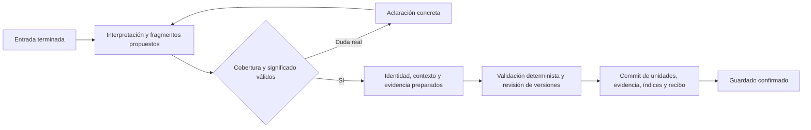

# Propuesta de núcleo de memoria v2

Implementación experimental R2 ampliada: el modelo selecciona límites de tokens y el servidor conserva literales; las aclaraciones distinguen fuentes/calendarios; una frontera paginada recupera candidatos con cobertura explícita. [Resultados y límites actuales](../09-planning/R2_INDEXED_VALIDATION.md). No sustituye las rutas desplegadas ni garantiza reconocimiento de toda paráfrasis.

Estado: **diseño y decisiones P1–P3 aceptados por el propietario el 2026-11-16**. Autoriza el prototipo y pruebas ficticias, sin tocar recuerdos reales. La [ADR-012](ADR/ADR-012-independent-memory-units.md) recoge la decisión; el [plan R0–R6](../09-planning/MEMORY_CORE_REBUILD_PLAN.md) fija entregas y puertas. El [motor aislado R1](../09-planning/R1_VALIDATION.md) ya está implementado con pruebas locales; interpretación con IA, integración y migración siguen pendientes. Los contratos desplegados continúan siendo K2–K4.

## 1. Qué queremos conseguir

Guardar todo el contenido que el propietario pide recordar, con su significado y procedencia; preguntar solo ante una duda real; poder corregir u olvidar un dato seleccionado sin reinterpretar ni reconstruir los asuntos ajenos. La interfaz conserva Explicar, Preguntar y Gestionar. No se añaden carpetas, etiquetas obligatorias o aprobación de cada guardado.

La IA interpreta lenguaje y propone datos. El servidor valida un modelo explícito y aplica cambios sobre identidades/versiones. **La selección de una ficha vigente y la confirmación de olvidarla no deben requerir otra inferencia de IA.** La corrección sí puede necesitar interpretar el texto nuevo; no debe necesitar reextraer el resto de la historia.

La fiabilidad tiene dos niveles distintos:

- Garantías del programa: aislamiento, alcance autorizado, versiones, atomicidad, idempotencia, retirada de todas las representaciones registradas y rechazo de trabajos antiguos. Deben comprobarse determinísticamente.
- Calidad semántica: separar asuntos, interpretar condiciones y reconocer paráfrasis. Es evaluable y mejorable, pero una segunda llamada al mismo modelo no la convierte en una garantía matemática. Debe poder pedir aclaración sin acusar al usuario de un fallo técnico.

## 2. Qué enseña el incidente y qué conservar

La investigación de solo lectura del 16 de noviembre encontró dos unidades vigentes con la misma evidencia amplia: ambas citas abarcaban el relato entero. La operación terminó sin aplicar el olvido y conservó ambas unidades. El mensaje encaja con la negativa del revisor de copias; no se conservó un motivo estructurado que permita identificar la comprobación semántica exacta. No se publica aquí contenido, identificadores ni capturas de recuerdos personales.

En la implementación actual, [forget.ts](../../backend/src/memory-control/forget.ts) inventaría fuentes y recuerdos, selecciona copias con IA, prepara restos de los relatos y solicita revisión antes del commit. [selection.ts](../../backend/src/memory-control/selection.ts) retira coincidencias literales de citas; la separación adicional intenta resolver citas compartidas. Un dato sencillo puede quedar ligado a todos sus vecinos por esa representación.

Ya existen transacciones, autorización, revisión de versiones, revocaciones y límites. No se atribuye el fallo a la ausencia de atomicidad, a Firebase o a la plataforma móvil. Se conservan esas fronteras, KMP/Compose, MVVM, Google/App Check, Secret Manager, consulta con evidencia y el perfil API Sol medio. Astra se usa para esta revisión de diseño; no es una decisión de cambiar el modelo de la app.

Cambian la unidad canónica, la propiedad de la evidencia, la identidad de las repeticiones y la planificación de cambios. Mejorar exclusivamente el prompt de borrado, quitar el revisor o probar modelos hasta que uno acepte no resuelve esa dependencia estructural.

## 3. Unidad gestionable: un significado, no una oración

Una unidad es una afirmación que se puede gestionar sin alterar otra afirmación independiente. Conserva sujeto, predicado/contenido, negación, modalidad, atribución, condición y tiempo que sean necesarios. No se exige convertir cualquier pensamiento en un catálogo rígido de predicados: puede tener contenido libre respaldado, dentro de un sobre tipado.

Ejemplo **inventado**, registrado el 10 de mayo en Europe/Madrid:

| Entrada | Resultado esperado |
| --- | --- |
| «Mañana quiero dibujar y en junio quiero aprender ajedrez» | Dos unidades: deseo de dibujar el día 11; deseo de aprender ajedrez en junio, sin inventar un día |
| «Elena me dijo que mañana dibujará y en junio aprenderá ajedrez» | Dos unidades atribuidas a Elena; comparten el marco de quién lo contó, no los dos planes completos |
| «Quiero leer Dune cuando Elena viaje» | Una intención condicionada; no crea el hecho de que Elena viaje ni una fecha inventada |
| «Antes prefería el té; ahora prefiero el café» | Evolución temporal explícita; dos estados relacionados, no corrección automática del pasado |
| «Me equivoqué: el taller es el jueves, no el viernes» | Corrección del taller identificado; la versión errónea deja de respaldar respuestas |
| Una cita literal, poema o pensamiento indivisible | Puede ser una sola unidad compuesta; no se fragmenta hasta perder significado |

Una relación con condición no se convierte en dos hechos independientes para facilitar el borrado. Si conservar B necesariamente revela A, la dependencia se modela al guardar; olvidar A requiere resolver ese alcance antes de confirmar. Compartir una persona, fecha o conjunción no es por sí solo esa dependencia.

Una unidad compuesta no es una salida de emergencia para almacenar como una sola ficha dos asuntos claramente independientes cuando falle el extractor. Si el significado es claro pero la representación no supera las invariantes, corresponde un fallo técnico sin guardado, no pedir aclaraciones lingüísticas irrelevantes.

En una enumeración, un predicado aplicado a todos sus elementos es contexto común, igual que el sustantivo compartido. Se separa de cantidades/colores/valoraciones particulares: cada unidad debe seguir acreditando qué se hizo con su objeto después de olvidar la otra. Un verbo exclusivo de una acción diferente no se comparte. La consulta recibe soportes vigentes agrupados por unidad y procedencia, sin posiciones ni longitud del relato incompleto; esos metadatos se conservan en el motor para validar y editar. Los huecos de otra unidad no invalidan evidencia propia ni permiten reconstruir lo retirado.

«Quedé con X para Y» conserva el acuerdo expresado sin afirmar que se celebró el encuentro o se realizó Y. «Ahora prefiero Y» acredita el estado relatado, pero no fecha su inicio: `time` sigue desconocido salvo fecha explícita del evento/cambio, y `recordedAt` no se convierte en comienzo de la preferencia. Una pregunta cotidiana de ubicación/cantidad puede contestarse con la observación guardada, indicando lo que el propietario contó; una cantidad posterior a un consumo o traslado no registrado sigue desconocida.

## 4. Modelo lógico propuesto

Todos los IDs son opacos y del propietario autenticado. Los nombres siguientes son conceptos de diseño; rutas físicas y DTO se fijan en R1, sin reutilizar silenciosamente el esquema de snapshots M0.

| Concepto | Contenido | Regla principal |
| --- | --- | --- |
| `MemoryUnit` | ID estable, revisión actual, contenido fiel en primera persona, tipo/modalidad/negación/atribución, tiempo del evento, relaciones tipadas | Una identidad gestionable; no depende del ID o la posición de otro recuerdo del relato |
| `EvidenceOccurrence` | ID, unidad/revisión respaldada, intervención, fragmentos de evidencia y contexto, instante de registro y zona | Varias veces que se contó el mismo dato pueden respaldar la misma unidad |
| `SourceEnvelope` | ID de intervención, canal, recepción/zona, orden de fragmentos y referencias vigentes | Procedencia; **no contiene otra copia permanente del texto completo** |
| `EvidenceFragment` | Texto literal, posiciones en la entrada admitida, rol, referencias de soporte/dependencia | Evidencia propia o contexto explícito; no guarda de incógnito otro asunto independiente |
| `MemoryRelation` | Extremos/versiones y clase: misma identidad, posible coincidencia, evolución, dependencia | Relacionado no equivale a duplicado ni autoriza borrar el vecino |
| `SearchProjection` | Unidad/revisión, referencias de dependencia, términos/vector y contenido derivado estrictamente necesario | Revocable y reconstruible solo desde el canónico vigente |
| `MutationPlan` | IDs/versiones, alcance, revisiones de membresía, política de esquema, caducidad y operación | Describe exactamente lo que se aplicará; sin inventario textual ni permiso aportado por el modelo |
| `OperationReceipt` | Estado, IDs mínimos, código seguro, marcas temporales, expiración | Informa de éxito, ausencia de cambio o incertidumbre; no guarda el texto previo |
| `Revocation` | ID retirado, revisión/época, operación e instante | Sin contenido o huella semántica, duradera para bloquear replays |

`MemoryUnit` mantiene solo su versión de contenido vigente. Una corrección conserva identidad y aumenta revisión; **no** crea una tabla consultable de versiones erróneas. Una evolución temporal sí conserva los hechos históricos verdaderamente relatados, con identidades y vigencias distintas. Un olvido retira la unidad y deja únicamente una revocación mínima.

### Evidencia sin un relato monolítico oculto

Durante la captura se dispone de la entrada completa de forma transitoria. Se prepara una partición ordenada de fragmentos literales y su mapa de propiedad. Cada fragmento con significado respalda una unidad, un grupo indivisible o un contexto identificado. Los separadores también tienen propiedad explícita para no conservar texto significativo fuera del mapa. Las posiciones se definen sobre la cadena exacta admitida, con una convención única a fijar en R1 y pruebas Unicode; no se normaliza la entrada antes de comprobarlas.

Un marco como «Elena me dijo que» puede respaldar dos unidades. La cláusula del primer plan no puede guardarse como contexto del segundo. Dos unidades independientes no pueden tener como evidencia principal el mismo bloque que contiene ambas. Se verifican estructura, cobertura y fidelidad antes de aceptar, incluyendo el contenido normalizado y cualquier metadato libre. La validación estructural detecta citas amplias idénticas; la semántica de otros solapamientos sigue necesitando evaluación.

Antes de cambios puede reconstruirse el texto admitido a partir de los fragmentos ordenados. Después solo se obtiene evidencia conservada con huecos identificados, nunca una supuesta transcripción original intacta. No se reescribe el hueco con IA ni se buscan todas las apariciones de una cadena con `replace`: se retiran IDs de fragmentos precisos. Corregir una aparición no toca otra cadena idéntica sin relación de propiedad.

«Texto admitido» excluye fragmentos que el propietario haya sustituido durante una aclaración o corrección. En «era jueves, no viernes», el valor anterior usado para identificar el error no se archiva como otra evidencia permanente después de corregirlo. La preparación distingue afirmación nueva y referencia al valor sustituido, valida el mapa de exclusión y conserva solo el soporte vigente. Si no puede hacerlo sin perder significado, no confirma el cambio. La entrada completa permanece únicamente durante la operación y en el feed RAM autorizado.

La admisión exige cobertura de **todos** los detalles relevantes, también pensamientos, adjetivos o restricciones que no aparezcan en el resumen de una tarjeta. Lo no representable permanece pendiente con una pregunta concreta; no se desecha como «irrelevante» ni se esconde en una fuente auxiliar. Una unidad compleja válida puede conservarse entera. La revisión debe detectar pérdida de detalle, no premiar únicamente resúmenes cortos.

Los contextos compartidos tienen referencias tipadas y recuento/membresía verificables. Si se elimina un plan, el marco que todavía respalda otro permanece. Si ese marco contiene el hecho que se desea olvidar, pertenece al cierre de dependencias que debe mostrarse antes del popup. No se promete impedir cualquier deducción lógica posible a partir de hechos ajenos: se retiran el dato, sus soportes y las dependencias explícitas que lo contienen, sin borrar recuerdos ajenos silenciosamente.

### Identidad y repeticiones

Se distinguen repetición de transporte, repetición del dato y semejanza temática:

1. Mismo requestId y entrada: mismo recibo, sin otra captura.
2. Mismo hecho/plan identificado: misma unidad, nueva evidencia de que se volvió a contar; no otra ficha independiente que haya que descubrir al borrar.
3. Mismo texto en otra fecha de evento, persona, condición, negación o modalidad: puede ser otra unidad. Ni embedding cercano ni texto idéntico bastan para fusionar.
4. Coincidencia dudosa: unidades independientes con relación `possibleSameAs`; no se fusionan por un porcentaje de confianza del modelo.

La búsqueda de posibles coincidencias ocurre al capturar/corregir o durante una reconciliación explícita. Es acotada, paginada y con estado de cobertura; no puede truncarse y declarar que no hay copias. Un enlace de misma identidad requiere contexto compatible y evidencia revisada; la identidad incierta de personas o eventos permanece incierta. No habrá fusiones destructivas silenciosas en segundo plano.

Un detalle adicional inequívoco sobre el mismo acontecimiento puede enriquecer la unidad: añade soporte, actualiza únicamente campos respaldados y aumenta revisión en un commit. Por ejemplo, añadir una hora a un taller ya identificado no crea otra copia del taller. No cambia campos existentes por omisión ni transforma una contradicción en enriquecimiento. Si no se sabe si es el mismo evento, se conserva la ambigüedad; no se fusiona solo para reducir fichas.

Al preparar un olvido, las repeticiones ya vinculadas se incluyen por referencias. Los candidatos ambiguos relevantes se muestran antes de confirmar, con una pregunta concreta sobre los datos afectados. No se pide al propietario que recorte citas internas. El cierre confirmado queda congelado y versionado. El clic final ejecuta ese cierre sin proveedor.

**Límite semántico explícito:** un índice, un clasificador o un conjunto finito de pruebas no pueden demostrar que no existe una paráfrasis no reconocida en toda la memoria. La garantía determinista cubre la identidad seleccionada, sus repeticiones vinculadas y el alcance adicional resuelto explícitamente. No se anunciará «he eliminado cualquier mención posible» si solo se conoce ese conjunto. El propietario acepta esta precisión de BR-009 en P2; todavía no sustituye el backend desplegado.

## 5. Guardar

La extracción devuelve un borrador tipado y relaciones, no escrituras ni IDs libres con autoridad. El servidor materializa las citas desde posiciones verificadas, valida cobertura, campos, referencias, cardinalidad y tiempo, y revisa fidelidad. Una fecha normalizada no sustituye el contenido de la unidad por toda su cita. Los límites/coste admitidos se reservan antes de llamar al proveedor.

La primera versión mantiene **todo el turno pendiente hasta resolver sus dudas**, sin guardado parcial oculto. Una aclaración corrige el segmento señalado; una reformulación completa puede reemplazarlo de forma explícita, manteniendo otros asuntos y sus referencias temporales. Tras una pregunta irrelevante o repetida, se ofrece reformular/cancelar y no se encadena un bucle de inferencias. No se atribuyen fallos de formato o revisión a faltas de ortografía.

Al finalizar, unidades, evidencia, proyecciones listas, membresías y recibo se confirman juntos, con autorización, concesión y revisión vigentes. Se elimina en ese commit el texto pendiente completo. No se muestra guardado con indexación esencial aún fallida; un fallo previo conserva un resultado honesto y recuperable. Una optimización futura de indexación asíncrona requeriría otro contrato de disponibilidad, no se incluye de entrada.

## 6. Tiempo, contradicción y corrección

Cada evidencia conserva `recordedAt` de servidor y la zona del turno. El tiempo del acontecimiento tiene precisión, valor/intervalo, literal y base de resolución explícitos. Una aclaración tardía no desplaza «mañana» del relato original. Si introduce su propio «mañana», se registra qué intervención lo ancla y se pregunta si no queda claro.

«El mes que viene» conserva precisión de mes; una condición futura no se convierte en evento ocurrido. Fechas de evento, registro y corrección son ejes distintos. Al editar un recuerdo antiguo, lo no editado mantiene su tiempo original; un nuevo marcador temporal usa el momento/zona de la edición salvo referencia explícita al original. Nunca se desplaza implícitamente un evento por volver a interpretar todo el texto a fecha de hoy.

Corregir desde una ficha aporta ID y revisión. La interpretación del texto nuevo produce un reemplazo para esa unidad, con evidencia de la edición. Los elementos no señalados no se vuelven a extraer. Una edición clara se aplica sin una confirmación redundante; una edición ambigua conserva el editor y explica qué necesita saber.

Antes del commit se determinan soportes antiguos que contienen el error y relaciones/proyecciones dependientes. Se retiran esos soportes erróneos, se escribe el contenido nuevo y se incrementa revisión; las otras unidades conservan ID, contenido, fechas y versión salvo una dependencia afectada explícitamente. El relato de procedencia puede quedar incompleto, sin copia oculta del valor erróneo. La fecha de creación y el instante de edición permanecen como metadatos; el valor previo solo queda en el feed RAM autorizado.

R2 materializa esa decisión mediante un manifiesto de conservación literal: cada fragmento antiguo de la unidad se particiona en palabras que siguen respaldando el dato y palabras retiradas. No se borra toda la evidencia solo porque cambió la ficha. La partición mantiene posiciones, fuente y ancla de registro; los propietarios ajenos conservan todas sus palabras. El motor valida propiedad/rangos/versiones y la revisión semántica comprueba suficiencia y retirada. Si dividir un ancla temporal compartida requiere afectar otra unidad, aborta sin cambios. El manifiesto no guarda una versión histórica ni convierte texto generado en evidencia original.

La corrección alcanza todas las ocurrencias de esa misma identidad, para que otra copia no restaure el valor antiguo. No corrige acontecimientos parecidos de fechas diferentes. Si el cambio afecta una condición compartida o cambia a qué evento se refiere, se aclara el alcance; no se propaga una sustitución textual a todo el almacén.

«Ahora prefiero otra cosa» es evolución; «lo anterior estaba mal» es corrección. Una contradicción sin esa intención no borra automáticamente el dato anterior. Tampoco se fusionan dos unidades contradictorias por compartir persona/tema. Se conserva la incertidumbre o se pregunta.

## 7. Olvidar

1. Desde la ficha, obtener unidad y revisión vigentes. Por conversación, resolver primero qué unidad se quiere olvidar; no interpretar una pregunta, cita o hipótesis como orden.
2. Preparar el cierre de soportes, repeticiones vinculadas, contextos exclusivamente propios, dependencias y proyecciones. Leer membresías/versiones de ese cierre, no reanalizar todos los relatos con IA.
3. Si existe un candidato ambiguo o una dependencia que afectaría otro dato, resolver esa decisión con una explicación específica **antes** del popup. Si la estructura es inconsistente, devolver incidencia técnica, sin inventar una duda del usuario.
4. Mostrar el popup de la app con el recuerdo y alcance real; por ejemplo «Lo has contado tres veces. Dejará de estar disponible». Cancelar no muta la memoria. «Sí, olvidar» acepta únicamente ese plan/versiones.
5. Confirmar sin IA: retirar unidad/soportes/proyecciones incluidos, actualizar referencias compartidas, invalidar pendientes asociados, escribir revocaciones y recibo y avanzar la época en la misma transacción.
6. Permanecer en Gestionar mostrando el resultado; conservar los otros recuerdos actuales. El feed RAM mantiene su original deshabilitado y el aviso nombrado, sin reutilizarlos como evidencia.

No hay recorte generativo ni revisión semántica posterior al clic en el caso normal. Si el plan caducó o la membresía cambió, no se amplía el borrado: actualizar alcance y confirmar de nuevo. Si la respuesta de red se pierde, consultar el recibo; no repetir inferencias ni reenviar con otro ID.

La primera versión solo admite cierres que caben íntegramente en la transacción presupuestada. Antes del popup calcula documentos, bytes y referencias. Un exceso produce `scope_too_large`, sin borrado parcial. A largo plazo podría revocarse una identidad completa y purgar en lotes; eso exige estado de limpieza, bloqueo de derivados y otra aceptación. No se simula ahora ni se etiqueta como borrado físico inmediato.

## 8. Consultar y gestionar

La búsqueda recupera unidades vigentes y sus propios soportes/contextos, **no** todos los relatos completos vecinos. Tras generar una respuesta, el servidor revalida IDs/revisiones, dependencias, revocaciones y época. Una fuente normalizada nunca acredita por sí sola un hecho que sus soportes no contienen. Se mantiene respuesta de tú y fichas en primera persona.

Las respuestas citan IDs de unidades, no un relato como sustituto de la evidencia exacta. ⋮ → Gestionar abre esas unidades actuales; el agrupado de una intervención es presentación. Leer Gestionar no vuelve a redactar/revisar las fichas con IA. Las referencias obsoletas no redirigen automáticamente a un dato distinto ni reactivan mensajes históricos.

El contexto de preguntas sigue siendo RAM acotada y nunca historial factual. Un cambio invalida contexto interpretativo, propuestas, selecciones y resultados en curso vinculados. El feed visual de la sesión mantiene su excepción solicitada por el propietario y se limpia al cerrar/reiniciar o tras 30 minutos en segundo plano. No se promete borrar remotamente la RAM de otro móvil ya abierto; este debe revalidar antes de actuar o consultar.

## 9. Autoridad, concurrencia y recuperación

El backend conserva la autoridad y los controles actuales de Google, App Check, propietario y secretos. Los planes del modelo no son permisos. UID, rutas, esquema, modelo y listas de documentos se resuelven/validan en servidor. Entrada y evidencia siguen siendo datos no confiables.

La preparación costosa ocurre fuera de transacciones. El commit solo lee estado actual, coteja revisiones/lease/epoch/membresías y escribe cambios predeterminados. Un reintento interno de Firestore no vuelve a llamar a IA. Esta separación respeta la [ejecución/reintentos de transacciones de Firestore](https://firebase.google.com/docs/firestore/manage-data/transactions).

Membresías de evidencia, duplicados y dependencias llevan revisión; cada alta/baja modifica esa revisión en el mismo commit. Así una nueva copia o un contexto añadido mientras está abierto el popup invalida el plan. Se retiene inicialmente la concesión de escritura por cuenta y la época global como guardia conservadora, con plazo/nonce y recuperación; optimizar conflictos ajenos es posterior, no motivo para quitar seguridad.

La operación se identifica por cuenta, ID y entrada ligada al intento. Los recibos caducan, pero la protección contra recreación no: se mantiene un registro mínimo sin texto de admisión/retirada de identidades de captura y operaciones destructivas. Un ID antiguo no puede volver a crear una fuente después de olvidar o de expirar el recibo. El mecanismo físico de este registro y los digests privados se fijan en R1; nunca se usa un hash público del recuerdo como identidad.

Tras un resultado incierto, el estado autorizado puede recuperarse sin el texto anterior. Un recibo de éxito anterior no devuelve contenido ya corregido o retirado. Los trabajadores deben comprobar revisión/época/tombstone antes de confirmar y antes de publicar una respuesta. Un reintento antiguo se bloquea; volver a contar deliberadamente un dato en una operación nueva es una nueva entrada autorizada, no una resurrección automática. No se conserva un fichero de hechos olvidados para censurar futuras entradas.

## 10. Estados y diagnóstico seguro

| Estado/código | Mensaje de sentido equivalente | Acción disponible |
| --- | --- | --- |
| `processing` con concesión vigente | «Sigo procesándolo» | Continuar en el chat; consultar estado |
| Resultado de transporte desconocido | «Aún no puedo confirmar si se ha aplicado» | Consultar recibo, sin reenviar como operación nueva |
| `needs_clarification / ambiguous_meaning` | «No he guardado/cambiado nada. ¿Qué quieres decir con…?» | Reformular o cancelar; contexto mínimo en pantalla |
| `needs_clarification / ambiguous_scope` | «Hay dos planes distintos. ¿Cuál quieres olvidar?» | Elegir alcance concreto |
| `not_applied / stale_version` | «El recuerdo ha cambiado. He actualizado lo que puedes gestionar» | Volver a seleccionar; otro popup si olvido |
| `not_applied / evidence_invariant` | «No he podido aplicar el cambio. El recuerdo sigue igual» | Seguir usando la app; incidencia técnica identificable |
| `not_applied / scope_too_large` | «Este cambio supera el alcance que puedo procesar de una vez. No he cambiado nada» | Resolver capacidad, sin fingir duda lingüística |
| `not_applied / provider_unavailable` | «No he podido interpretar el texto ahora. No he cambiado nada» | Reintento explícito admitido |
| `committed` | Guardado, corregido u olvidado confirmado | Leer estado actual; no repetir escritura |

`not_applied` solo se devuelve con evidencia de no commit; una desconexión no lo prueba. Un fallo al refrescar Gestionar después de un commit conserva la confirmación y permite recargar la lectura. Los estados son terminales o tienen vencimiento verificable; no dejan el editor bloqueado indefinidamente.

El recibo/telemetría puede guardar esquema, etapa, código cerrado de rechazo, intento, duración, cantidades/coste y correlación opaca. No guarda preguntas, textos, resúmenes, valores X/Y, prompts, salidas del proveedor ni sus errores sin filtrar. Un revisor deberá producir códigos de motivos, no solo `allowed:false`; esos códigos son diagnóstico, no prueba de que su juicio sea correcto. TTL operativo y presupuestos siguen explícitos.

## 11. Retención, costes y capacidad

Fuentes segmentadas, unidades y evidencia vigentes permanecen hasta una mutación autorizada. El texto completo pendiente mantiene como máximo la retención operativa vigente de 24 h, se elimina explícitamente al confirmar/cancelar y nunca entra en búsqueda. Recibos terminales sin contenido: siete días; contadores numéricos: 30 días; revocaciones mínimas: sin TTL. No se activan backups históricos/PITR ni persistencia local de recuerdos.

TTL es una red de limpieza, no una barrera de lectura ni un borrado inmediato; tampoco elimina automáticamente subcolecciones. El diseño exige expiración lógica y limpieza explícita de pendientes y documentos dependientes. [Comportamiento oficial de TTL](https://firebase.google.com/docs/firestore/ttl).

Propuesta inicial de presupuesto del prototipo: conservar entrada de 8000 caracteres y hasta ocho unidades por turno; más contenido requiere dividir la intervención sin pérdida silenciosa. Cierre de mutación: hasta 32 unidades, 128 soportes y 400 escrituras, con máximo interno de 2 MiB de solicitud estimada y margen de índices. Son **cotas propias a validar**, no límites de Firebase ni rendimiento acreditado. La cota más restrictiva incluye todas las evidencias, fragmentos, relaciones, recibos e índices afectados. No admite truncar el cierre.

La admisión también comprueba capacidad futura de gestión: no puede aceptar una repetición/enlace que vuelva imposible olvidar esa identidad dentro de las cotas soportadas. Un exceso requiere resolver capacidad antes de guardarlo, con un mensaje técnico concreto; no crea otra identidad falsa ni descarta evidencia anterior para esquivar el límite. R2/R3 deben demostrar que estas cotas son adecuadas para el uso previsto. Una purga escalable posterior debe diseñarse antes de habilitar volúmenes que la necesiten.

Todo campo persistido con contenido, incluidos textos de ficha, términos, entidades y resúmenes de búsqueda, declara de qué unidad/evidencia depende. No se permiten perfiles globales de personas, cachés narrativas o etiquetas libres de relaciones que oculten otra copia fuera del cierre de retirada. Los enlaces sin contenido a una unidad retirada se limpian o invalidan igualmente.

El coste de reconocer significados/repeticiones se traslada sobre todo a la admisión. Debe medirse: menos IA al olvidar no implica automáticamente menos coste total. Las lecturas de gestión y el commit de olvido explícito tienen presupuesto de **cero llamadas de IA**. Captura/corrección mantienen llamadas y plazos máximos, sin reintentos semánticos automáticos hasta obtener aceptación. La búsqueda de respuesta no se reutiliza como inventario exhaustivo para borrar.

Antes de implementar el adaptador se revisan [límites de Firestore](https://firebase.google.com/docs/firestore/quotas), tamaño real de documentos/índices y carga del corpus; no se confunde el límite de transformaciones por documento con un presupuesto de escrituras del producto. El plan incluye ampliar la memoria sintética y medir fan-out, latencia y coste antes de fijar capacidad de uso.

## 12. Decisiones de producto aceptadas

P1, P2 y P3 aceptadas expresamente por el propietario el 2026-11-16. Se conservan las alternativas consideradas para explicar el criterio. Aceptar el diseño y probar con fixtures no autoriza transformar datos reales ni activar producción.

| ID | Recomendación | Alternativa e impacto |
| --- | --- | --- |
| P1 · Evidencia original | Conservar palabras originales en fragmentos con propiedad/contexto; sin copia monolítica paralela. Tras un cambio, solo evidencia restante y procedencia, además del feed RAM ya autorizado | Conservar íntegro el relato incluso después de olvidar contradice la retirada; un archivo histórico aparte necesitaría cambiar explícitamente privacidad y alcance |
| P2 · Alcance de copias | Olvidar la identidad seleccionada y todas sus repeticiones vinculadas; resolver candidatos ambiguos y dependencias antes del popup. Explicar alcance real sin prometer exhaustividad semántica universal | Mantener la promesa de todas las paráfrasis desconocidas exige búsquedas/revisión global falibles y bloqueos, incluso con evidencia separada; no es garantía absoluta |
| P3 · Corrección y evolución | Editar corrige toda esa identidad; un cambio real en el tiempo crea otro estado/acontecimiento. Solo aclarar si hay ambigüedad | Editar una sola ocurrencia mantendría copias contradictorias; borrar siempre el pasado perdería historia verdadera |

P1–P3 ya no requieren otra aprobación para desarrollar el alcance autorizado. Se mantienen las demás decisiones: guardar claro automáticamente, confirmar todo olvido, preservar asuntos ajenos, internet obligatorio, una cuenta, sin audio archivado ni copias históricas. La integración/migración conserva sus puertas específicas de validación y autorización.

## 13. Qué no resuelve por sí sola

La separación no garantiza interpretar bien cualquier frase ni reconocer todas las equivalencias. Una partición incorrecta puede seguir perdiendo contexto; el corpus debe buscar esos fallos. No promete escala ilimitada, latencia perfecta, ausencia total de interrupciones o borrado de copias del proveedor/dispositivos externos. No necesita una base de grafos, otro proyecto Firebase o un modelo más caro para empezar. La mejora se acreditará con ciclos completos y fallos inyectados, no por el número de diagramas o de revisores de IA.
