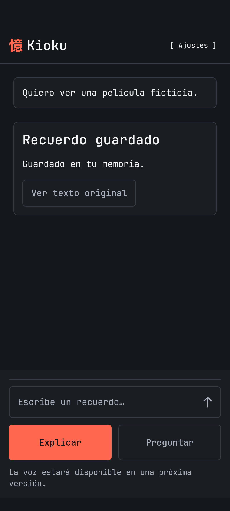
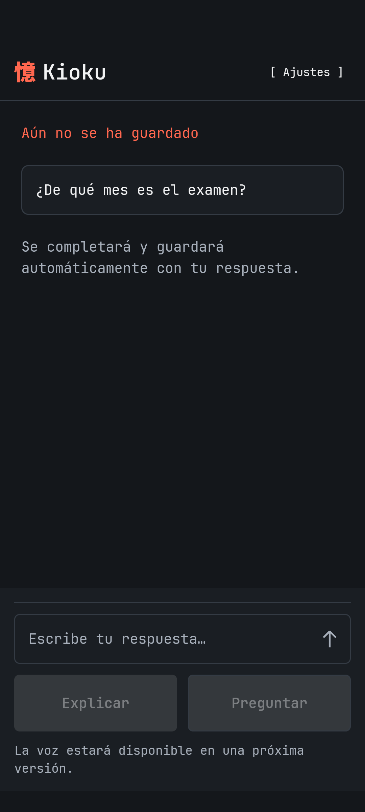

# K2 · Captura por escrito

Rama: `codex/k2-text-memory`, desde `2f18f23`. **Estado: implementada y desplegada; aceptación del nuevo build en móviles pendiente.** No es cierre de K2 ni de K1/iOS.

## Alcance de esta entrega

Contar por escrito, aclarar dudas en el mismo recorrido y confirmar guardado solo tras el commit. Fuente original y fragmentos normalizados en Firestore por UID, reintentos idempotentes, recuperación explícita de estado incierto y acceso a la fuente confirmada. Preguntar no invoca captura ni guarda preguntas: K3 sigue pendiente. Voz, ofertas, corrección y olvido conversacionales siguen fuera de esta entrega.

Se consultaron arquitectura, datos/API, seguridad/privacidad/retención, plan/limitaciones, flujos/casos, convenciones y calidad. Se inspeccionaron mediante Stitch MCP las vistas 03 · Aclaración, 04 · Guardado y 07 · Fuente, conservando tipografía, controles y preferencias posteriores del propietario. No se editó Stitch. [ADR-009](../02-architecture/ADR/ADR-009-text-capture.md) registra las decisiones de implementación.

## Evidencia local

| Comprobación | Resultado observado |
| --- | --- |
| Backend `node tooling/backend.mjs build` | TypeScript strict; núcleo M0 compilado desde sus fuentes originales |
| Backend `node tooling/backend.mjs test` | 14 pruebas unitarias existentes correctas |
| `pwsh -NoProfile -File tooling/backend-emulators.ps1` | 24 pruebas correctas, solo `demo-kioku-local`; incluye 11 casos nuevos de captura/HTTP y ampliación de reglas |
| M0 `check` y `test` mediante su npm fijado | 74 pruebas correctas; sin cambios en prompts/modelo/extracción |
| Android APK y APK de tests | Compilados con las herramientas fijadas |
| `pwsh -NoProfile -File tooling/mobile.ps1 mobileCheck` | Formato, arquitectura, Detekt, 26 host tests y Android Lint correctos |
| Pruebas instrumentadas Android | 16/16 correctas en API 36 con letra al 200 %. Los tres casos nuevos se repitieron a tamaño normal para capturas, con cuenta/repositorio ficticios |
| iOS | Puente Functions y entrada Compose preparados, archivo Swift registrado en Xcode; no compilado ni ejecutado en Windows |

Casos nuevos: commit y replay sin duplicados; reutilización conflictiva del ID; aclaración sin memoria anticipada; error del proveedor sin fuente parcial; límites/concurrencia; trabajadores tardíos; revocación antes del commit; caducidad; reservas distribuidas; identidad ajena, modo/UID/clave/zona inyectados; respuesta móvil malformada; cancelación y resultados tardíos; Preguntar sin escritura. Los dobles de IA no prueban calidad semántica del proveedor. Las revisiones no debilitaron aserciones: se corrigió una llamada recursiva en el fake y un import de API de tests, además de límites/advertencias reales del código.

La primera prueba de interfaz detectó dependencia de un repositorio simulado anterior. Se pasó explícitamente la dependencia actual por parámetros Koin al ViewModel, como la cuenta; no se borró el estado del dispositivo ni se relajaron aserciones. El envío cierra el teclado; las pruebas ejercitan IME Send y el botón mediante un único envío, esperan estados concretos sin sleeps y verifican visibilidad, fuente y número de peticiones. Letra del emulador restaurada y emulador cerrado; móviles personales intactos. Se retira la dependencia local innecesaria `kioku:file:..` del backend para que el paquete desplegable no dependa de copiar la raíz del workspace; el núcleo compilado queda dentro de `backend/lib`.

## Proveedor real con persistencia aislada

`pwsh -NoProfile -File tooling/backend-emulators.ps1 -LiveCaptureSmoke` usa la clave existente autorizada y conserva el contador/límite acumulado de M0. [Resultado seguro](k2-live-smoke-2026-11-13.json): dos casos nuevos ficticios con **Sol medium**, seis llamadas, 7869 tokens de entrada y 463 de salida, **0,023814 USD estimados**. Entrada de dos asuntos guardada en 12,698 s; ambigüedad aclarada y guardada en 5,201 s de procesamiento de la respuesta. Fuente/aclaración conservadas y replay sin llamar a la IA. Los datos de Firestore demo se limpiaron al terminar. No se usó el Firebase de producción para almacenar estos relatos.

No son tres rondas de aceptación ni una medición p95; el objetivo de latencia M0/K2 sigue abierto. La evidencia M0 de 74 pruebas/tres rondas no se convierte en prueba de IAM/App Check/iOS por reutilizar el núcleo.

## Activación remota

Despliegue autorizado en `kioku-9454f`, `europe-west1`: `getConfiguration`, `submitTurn`, `resolveClarification`, `getOperation` y `getSource` activos con la identidad de ejecución prevista. Se concedió lectura únicamente del secreto existente `kioku-openai-owner`; no se creó ni rotó ninguna clave. TTL de `operations` y `usage` comprobados en estado `ACTIVE`. Fuentes y recuerdos no tienen TTL. PITR desactivado y cero programaciones de backup.

El primer despliegue falló por una entrada `picomatch` ausente del lockfile. Se regeneró con npm 10 compatible con la compilación remota, se comprobó instalación limpia y se repitieron compilación y 14 pruebas backend. El siguiente despliegue terminó correctamente. La instalación de herramientas mostró avisos de obsolescencia de dependencias transitivas de OpenTelemetry; no se desactivaron comprobaciones.

Tras autorización expresa, las cuatro funciones K2 admiten entrada HTTPS mediante `roles/run.invoker` para `allUsers`, como la configuración K1. Esto permite llegar al endpoint, sin autorizar acceso a los recuerdos: siguen exigiendo Google, cuenta permitida y App Check. Las cuatro peticiones HTTPS sin credenciales se rechazaron con 401. Esta comprobación negativa no sustituye la aceptación positiva desde el móvil.

Se corrigió además el puente de respuesta para aceptar números enteros serializados como `1.0` o `1e0` por SDKs nativos, rechazando fracciones; dos host tests nuevos verifican esa frontera. `mobileCheck` y APK se reconstruyeron después. Las 16 pruebas instrumentadas preceden a estos últimos ajustes de protocolo, copy y estabilidad de la instancia iOS; no se presentan como una ejecución nueva del último APK. El repositorio iOS se crea fuera de la recomposición; sigue pendiente compilarlo en Mac.

| Guardado · fixture Android | Aclaración · fixture Android |
| --- | --- |
|  |  |

## Aceptación pendiente

- Instalar como actualización y comprobar captura/clarificación/fuente en Android con Google/App Check reales; compilar y comprobar la integración en Mac/iOS. No sustituir estos resultados por fixtures o acceso K1 de un build anterior.
- APK preparado en el PC, sin instalación automática en móviles personales. El propietario confirma «Recuerdo guardado» tras probar desde su Android. Confirma el recorrido positivo de captura con Google/App Check reales; la revisión del texto original y el caso ambiguo siguen pendientes de su respuesta. No se copian recuerdos personales a la evidencia.
- No declarar consulta, corrección, olvido o voz disponibles hasta sus fases. No usar datos insustituibles como primera aceptación.
